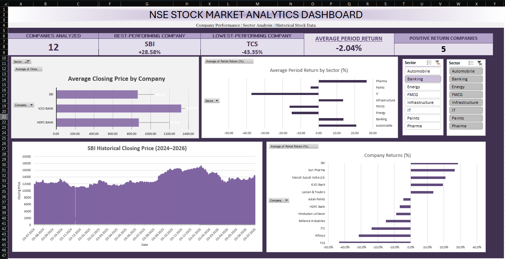
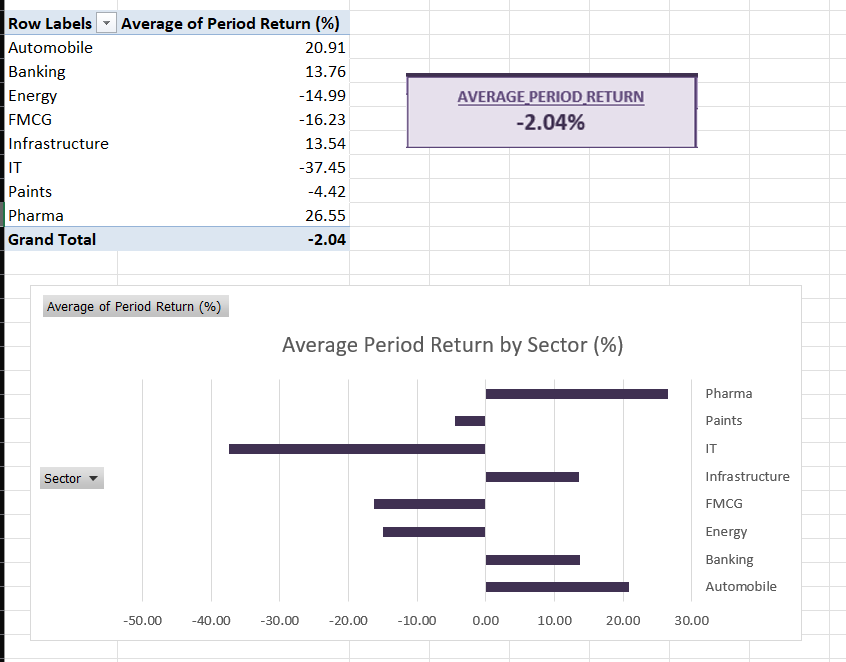

# Stock Market Analysis Dashboard

A stock market analysis project that uses Python, Pandas, and Microsoft Excel to explore historical stock prices, compare company performance, and identify sector-level trends.

## Project Overview

This project analyzes historical stock market data for 12 companies across multiple sectors. The workflow includes data collection, cleaning, exploratory data analysis, performance calculations, and interactive visualization through an Excel dashboard.

## Tools and Technologies

- **Python** — data collection and analysis
- **yfinance** — historical stock market data
- **Pandas** — data cleaning, transformation, and analysis
- **Microsoft Excel** — dashboard creation, charts, KPIs, and slicers
- **Git and GitHub** — version control and project documentation

## Project Workflow

1. **Data Collection:** Download historical stock data using `yfinance`.
2. **Data Cleaning:** Handle missing values, validate records, and remove duplicate company-date entries.
3. **Exploratory Data Analysis:** Examine data quality, price movements, daily returns, and trading volumes.
4. **Performance Analysis:** Calculate company returns, average closing prices, volatility, and sector-level performance.
5. **Visualization:** Present key findings through an interactive Excel dashboard.

## Dashboard Preview

### Stock Market Dashboard


### Sector Returns Analysis


## Key Analyses

- Company-wise stock performance
- Daily price returns and trading volume
- Average closing prices and volatility
- Sector-wise performance comparison
- Identification of unusually large price movements and trading volumes

## Project Structure

```text
Stock-Market-Analysis-Dashboard/
├── Dataset/
│   ├── raw/
│   └── cleaned/
├── Documentation/
│   └── business_qs.md
├── Excel/
│   └── Stock_Market_Dashboard.xlsx
├── Images/
│   ├── stock_market_dashboard.png
│   └── sector_returns_analysis.png
├── Python/
│   ├── download_data.py
│   ├── cleaning.py
│   ├── eda.py
│   └── build_dashboard.py
├── .gitignore
└── README.md
```

### Stock Market Dashboard



### Sector Returns Analysis




## How to Run

1. Clone this repository.
2. Create and activate a Python virtual environment.
3. Install the required Python packages, including `pandas` and `yfinance`.
4. Run `download_data.py` to collect historical data.
5. Run `cleaning.py` to generate the cleaned dataset.
6. Run `eda.py` to generate the analysis summaries.
7. Open the Excel dashboard to explore the visualizations.

Run the scripts from the project root, and ensure that the required dataset and company ticker file are available.

## Data Quality Note

An unusually large daily price movement and trading-volume spike were identified in ITC's historical data. This observation is being investigated before a definitive conclusion is drawn about its cause or accuracy.

## Author

Diya Samanta
B.Tech — Computer Science and Business Systems
Institute of Engineering and Management, Kolkata

[GitHub Profile](https://github.com/diya07kki)
